# Boardroom Skills

**Boardroom-ready deliverables from your coding agent, in one prompt.**

Agent Skills for Claude Code, Codex and Cursor that turn a rough brief into the file a client or board actually receives: a pitch deck with editable charts, a 3-statement Excel model, a contract review, a proposal with pricing options. Each skill ships the scripts that build the file, a design system, a QA checklist the agent runs on its own output, and a real example you can open before you install anything.

This repository is the **free tier** (4 skills, MIT). The other 8 skills are in **Boardroom Skills PRO** (see [Pricing](#pricing)). *Disclosure: I make this and sell the PRO tier.*

## Gallery

Every image below is a screenshot of a file generated by the skill from the fictional brief in its `examples/input.md`. Pro skills are labelled `PRO`; their previews are screenshots only. Free skills include the full example output files.

<table>
<tr><td width="33%" valign="top">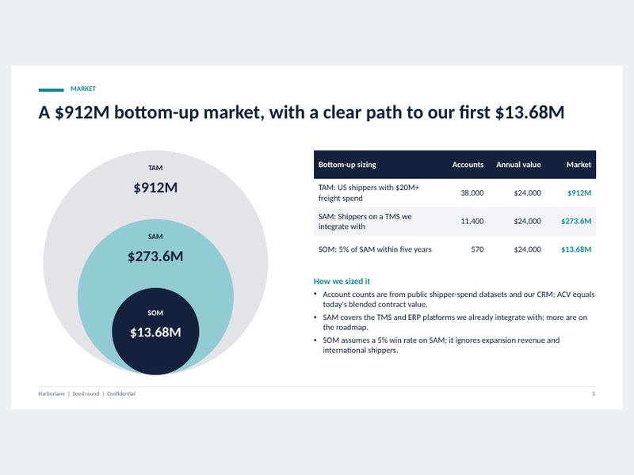<br><b>Investor pitch deck</b> &nbsp;<code>FREE</code><br><sub>13-slide seed / Series A narrative with editable charts.</sub></td><td width="33%" valign="top">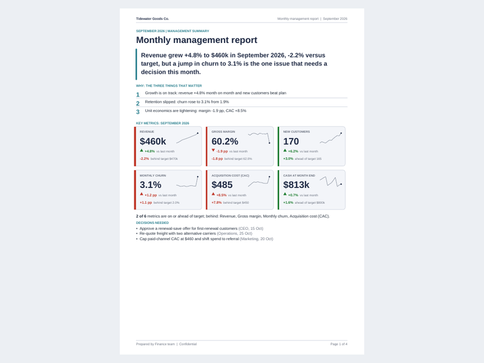<br><b>Monthly KPI report</b> &nbsp;<code>FREE</code><br><sub>Answer-first management report from a CSV and a notes file.</sub></td><td width="33%" valign="top">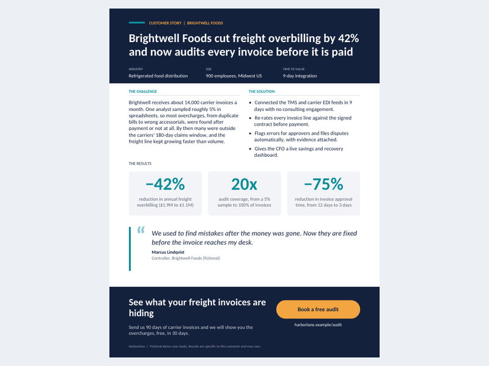<br><b>Customer case study one-pager</b> &nbsp;<code>FREE</code><br><sub>Challenge, solution, three headline results and a quote on one page.</sub></td></tr>
<tr><td width="33%" valign="top">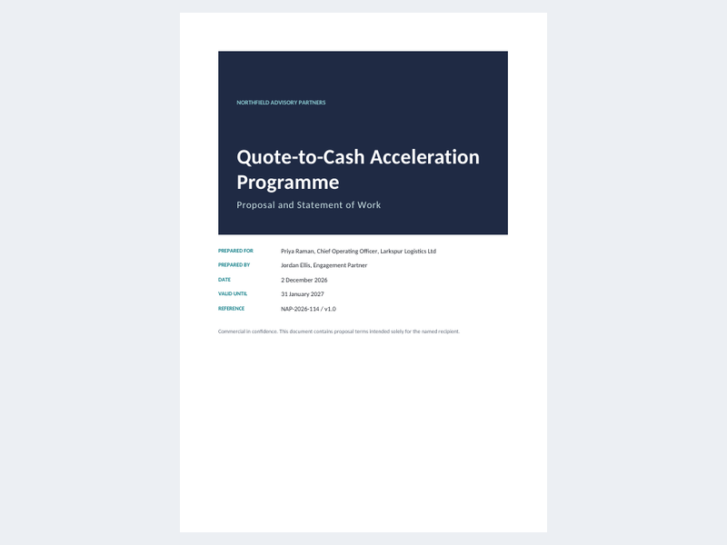<br><b>Proposal and SOW</b> &nbsp;<code>FREE</code><br><sub>Client-ready proposal with phased plan and good/better/best pricing.</sub></td><td width="33%" valign="top">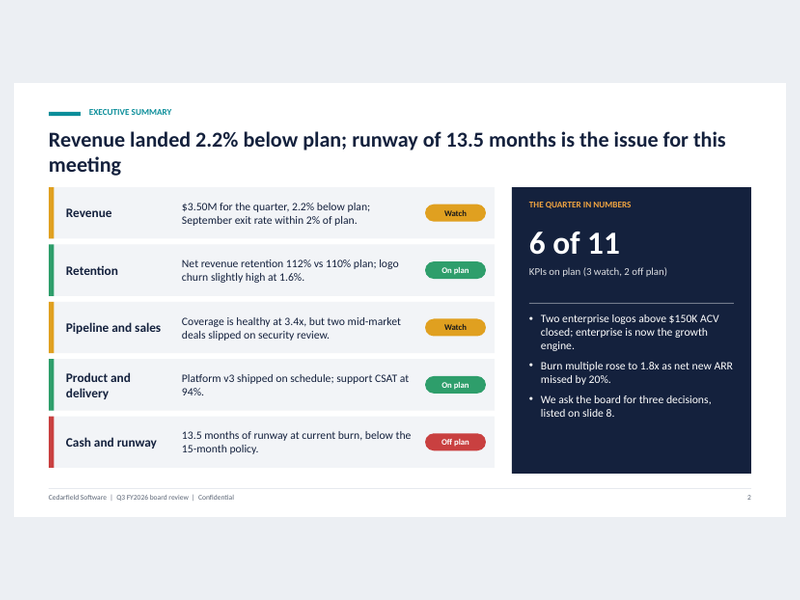<br><b>Board / QBR deck</b> &nbsp;<code>PRO</code><br><sub>Quarterly board deck with RAG status and variance maths.</sub></td><td width="33%" valign="top">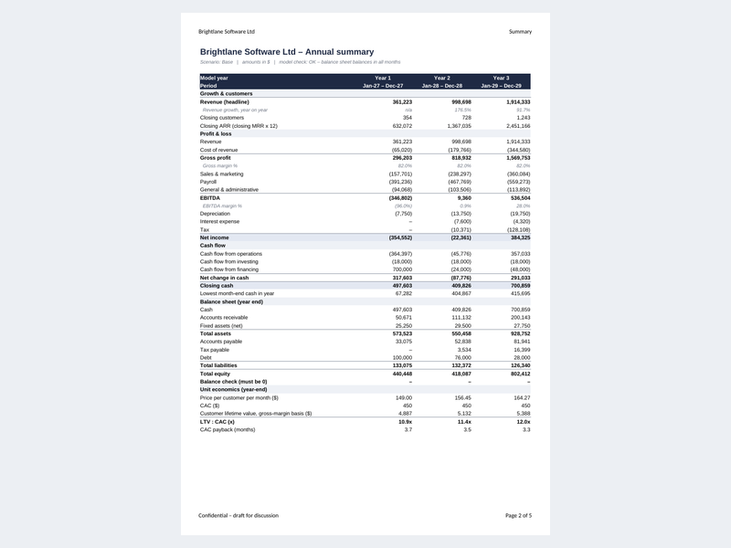<br><b>3-statement financial model</b> &nbsp;<code>PRO</code><br><sub>36-month model in live Excel formulas.</sub></td></tr>
<tr><td width="33%" valign="top">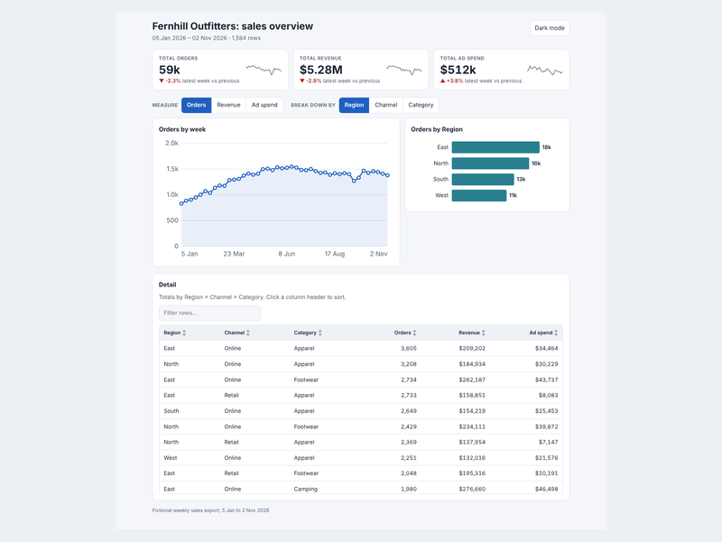<br><b>Data dashboard</b> &nbsp;<code>PRO</code><br><sub>One self-contained HTML dashboard from a CSV.</sub></td><td width="33%" valign="top">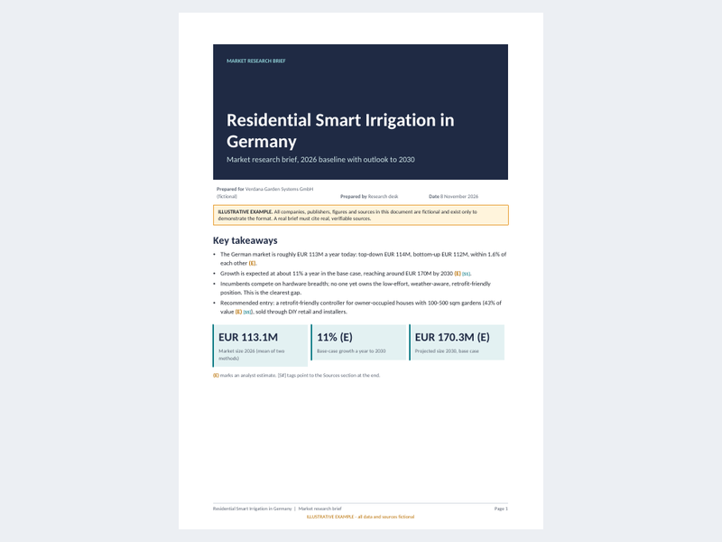<br><b>Market research brief</b> &nbsp;<code>PRO</code><br><sub>Market sizing and competitor landscape with the maths shown.</sub></td><td width="33%" valign="top">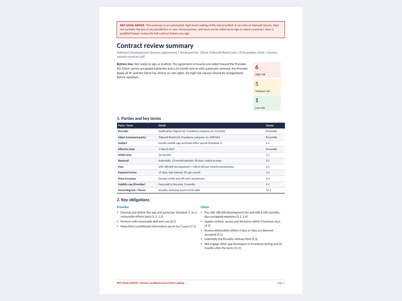<br><b>Contract review summary</b> &nbsp;<code>PRO</code><br><sub>Plain-English first-pass review of a contract (not legal advice).</sub></td></tr>
<tr><td width="33%" valign="top">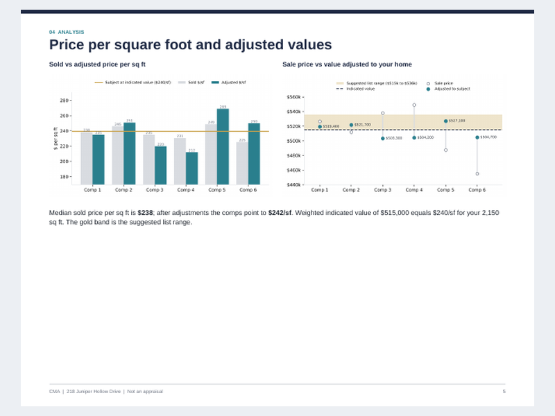<br><b>Real-estate CMA pack</b> &nbsp;<code>PRO</code><br><sub>Comparative market analysis from comps and a subject property.</sub></td><td width="33%" valign="top">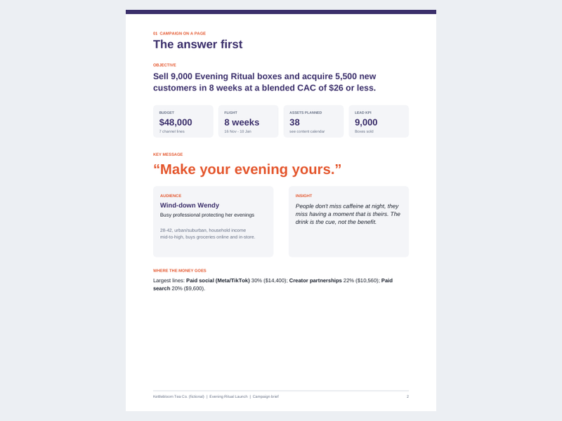<br><b>Marketing campaign brief</b> &nbsp;<code>PRO</code><br><sub>Campaign brief plus a working content calendar.</sub></td><td width="33%" valign="top">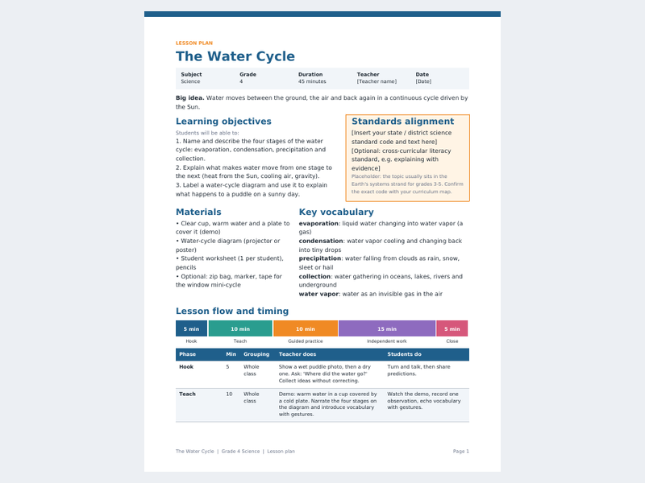<br><b>Lesson plan + worksheet</b> &nbsp;<code>PRO</code><br><sub>Teacher pack for one lesson.</sub></td></tr>
</table>

## Install in 30 seconds

### Claude Code (plugin marketplace)

```text
/plugin marketplace add boardroomskills/boardroom-skills
/plugin install boardroom-skills@boardroom
```

Then ask for what you want, or call a skill directly:

```text
/boardroom-skills:investor-pitch-deck  build a seed deck from notes.md
```

### Claude Code (manual copy, no plugin)

```bash
git clone https://github.com/boardroomskills/boardroom-skills.git
mkdir -p ~/.claude/skills
cp -r boardroom-skills/skills/* ~/.claude/skills/
```

Use `.claude/skills/` inside a project to scope them to that project.

### Codex and Cursor

Skills are plain folders with a `SKILL.md`, so any agent that reads Agent Skills can use them. Copy the folders from `skills/` into the directory your agent scans:

| Agent | Directory |
|---|---|
| Codex | `~/.codex/skills/` or `~/.agents/skills/` (check which one your Codex version scans; project-level: `.agents/skills/`) |
| Cursor | `.cursor/skills/` (project) or `~/.cursor/skills/`. Cursor also reads `~/.claude/skills/` |

Restart the agent so it re-scans. Cursor and Codex have changed their skills support more than once; if a skill does not show up, check your version's docs first. I test mainly with Claude Code.

### Python dependencies

The skills run Python scripts. Install what a skill needs from its `requirements.txt`, for example:

```bash
pip install -r skills/investor-pitch-deck/requirements.txt
```

Some QA and preview steps use LibreOffice (`soffice`) and poppler (`pdftoppm`). The agent will tell you if they are missing.

## What each skill produces

| Skill | Tier | What it produces |
|---|---|---|
| `investor-pitch-deck` | FREE | A .pptx with native PowerPoint charts, bottom-up TAM/SAM/SOM, use-of-funds maths and three colour themes. |
| `monthly-kpi-report` | FREE | A multi-page PDF: headline KPI tiles vs last month and target, trend charts, commentary, risks, next steps, appendix table. |
| `case-study-one-pager` | FREE | A one-page PDF and a matching one-slide .pptx, with result percentages computed from the numbers you supply. |
| `proposal-sow` | FREE | An editable .docx plus a PDF: executive summary, phases with a Gantt-style timeline, deliverables, assumptions, three pricing options, signature block. |
| `board-qbr-deck` | **PRO** | A 9-slide .pptx: KPI scorecard vs plan, revenue and burn/runway charts, wins and misses, risk table, decisions needed, next-quarter priorities. |
| `financial-model` | **PRO** | An .xlsx with Assumptions, monthly P&L, cash flow, a balance sheet that balances, annual summary, base/upside/downside switch and charts, plus a LibreOffice validator. |
| `data-dashboard` | **PRO** | A single offline .html file: KPI tiles, time-series and breakdown charts as inline SVG, sortable/filterable table, light and dark mode, mobile layout. |
| `market-research-brief` | **PRO** | A 6-10 page PDF: top-down and bottom-up sizing, segments, trends, competitor table, 2x2 positioning chart, sources; every number cited or marked as an estimate. |
| `contract-review-summary` | **PRO** | A 2-4 page PDF: parties, term, fees, obligations, a clause risk table with suggested redlines, missing clauses, questions to ask. Always carries a not-legal-advice notice. |
| `real-estate-cma-pack` | **PRO** | A listing-presentation PDF with adjustment grid, price-per-sq-ft analysis and suggested list-price range, plus a one-page flyer. Labelled an opinion of value, not an appraisal. |
| `marketing-campaign-brief` | **PRO** | A brief PDF (objective, persona, insight, channel plan with budget chart, KPIs, timeline) and an .xlsx calendar with dropdowns, conditional formatting and live formulas. |
| `lesson-plan-worksheet` | **PRO** | Three PDFs: lesson plan, student worksheet with varied question types, and an answer key with scoring notes. Typography adapts to grade band. |

Free skills are in `skills/`. Each has `SKILL.md` (the instructions), `scripts/`, `templates/` and `examples/` (the brief, the real output, previews).

## How it works

A skill is a folder the agent loads on demand. When your request matches a skill's description, the agent reads `SKILL.md`, asks you for any missing facts, fills a small JSON/CSV config, runs the build script, then re-opens the output and runs the QA checklist (overflow, empty placeholders, formula errors, numbers that disagree between slides). The scripts are deterministic: the same inputs give the same file, and they need no network and no API keys.

Rules every skill follows: it asks for missing inputs instead of inventing facts about your business, placeholders are visibly marked, numbers are computed once and reused so they match everywhere, and Excel outputs use live formulas.

## Honest limitations

- **These produce a strong first draft, not a finished document.** Read every output before it leaves your hands. Check numbers against your source data.
- **Quality depends on your inputs and on the agent model you run.** Thin briefs give thin decks. The skills ask questions; answer them.
- **Not professional advice.** The contract review is a plain-English first pass, not legal advice. The financial model is a modelling scaffold, not a valuation. The CMA is an opinion of value, not an appraisal. (Those three are PRO skills; the notices are built into their outputs.)
- **Fixed layouts and themes.** You get a few themes per skill. Deep brand matching (custom fonts, logo-locked templates) means editing the templates yourself.
- **System fonts only**, so Word/PowerPoint on another machine may reflow slightly.
- **English-first.** Other languages work to the extent the model writes them; layouts were designed and checked with English text.
- **Developed and tested on Linux with Python 3.9+.** macOS and Windows should work but are less tested.
- **No web access inside scripts.** Research (for example in the market brief) uses your agent's own web tools, if it has them.

## Pricing

| | Free | PRO |
|---|---|---|
| Skills | 4 (this repo) | all 12, plus new skills monthly |
| Price | $0, MIT | **$9.99 / month**, **$79 / year**, or **$49 founding lifetime** |
| Access | public | private GitHub repo, access granted automatically on purchase |

- [Monthly, $9.99](https://buy.polar.sh/polar_cl_DH7gguHUD2rrUAR03HE8JdiTuI0apICjSRy6G2qSgDE)
- [Yearly, $79](https://buy.polar.sh/polar_cl_KwzsVgrR1wzqR9L8rAb5ckWAMZ5Ax2U0naTXU1873IK)
- [Founding lifetime, $49](https://buy.polar.sh/polar_cl_8Eluoz141SBwedlUioV2Tea75cSlmBXNbJeQq092AAF) (first 30 days after launch, limited to the first 100 buyers)

Checkout and tax are handled by Polar. After you pay, Polar invites your GitHub account to the private `boardroom-skills-pro` repo; accept the invite, then run the PRO install commands in that repo's README. Cancelling a subscription removes repo access.

PRO adds: `board-qbr-deck`, `financial-model`, `data-dashboard`, `market-research-brief`, `contract-review-summary`, `real-estate-cma-pack`, `marketing-campaign-brief`, `lesson-plan-worksheet`.

## FAQ

**Do the free skills work without paying?** Yes. They are MIT licensed, with no keys, no telemetry and no account.

**Which agents does it work with?** Built for Claude Code. The format is the open Agent Skills layout (`SKILL.md` plus scripts), so Codex and Cursor can load it too; see the install table.

**Is this just prompts?** No. Each skill includes tested Python that builds the file (python-pptx, openpyxl, reportlab, python-docx, matplotlib). The instructions tell the agent how to drive them and how to check the result.

**Can I edit the output?** Yes. Decks, Word files and spreadsheets are native, editable files with real charts and live formulas, not images.

**Where does my data go?** The scripts run locally and make no network calls. Your agent, of course, sends your conversation to its own model provider as usual.

**Can I use the output for clients?** Yes. Files you generate are yours.

**What does PRO get me over the free tier?** The other 8 skills and monthly additions. Previews of all of them are in the gallery above.

**Can I fork or redistribute the free skills?** Yes, under the MIT licence. PRO has a single-user, no-redistribution licence.

**Something is broken or missing.** Open an issue. Include the skill name, your agent and version, and what you asked for.

## License

The skills in this repository are MIT licensed (see `LICENSE`). PRO skills are separately licensed.
